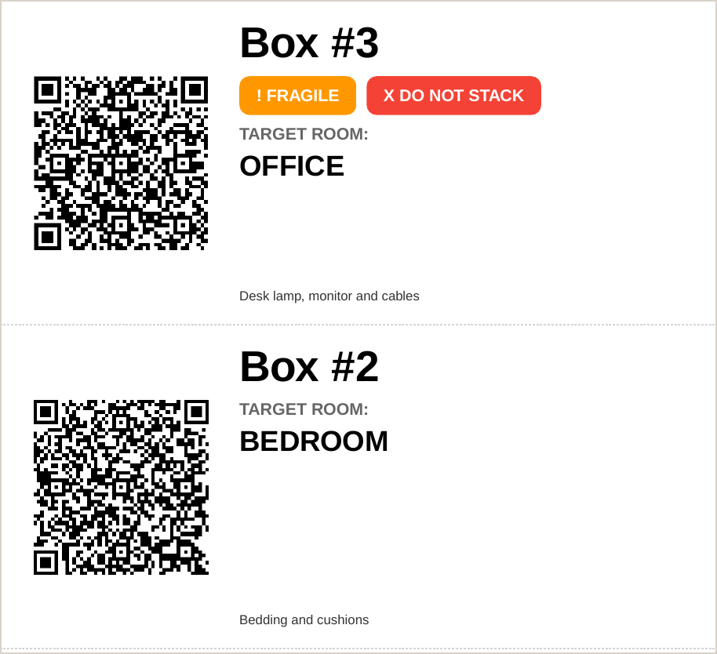

# BoxCopilot

[](https://www.gnu.org/licenses/gpl-3.0)

BoxCopilot tracks what is packed in each moving box and where it has to go. Label every box with a QR code, let helpers scan it without an account, and find the coffee maker without opening 20 boxes.


## What it does

- Boxes have a current room, a target room, a description and handling flags (Fragile, Do not stack). A progress card counts how many boxes have reached their target.
- Items carry photos from the in-app camera or the gallery. Search by item name finds the box.
- Labels come as an A4 PDF with three labels per page. Each one has a QR code that opens the box on a public, read-only page.
- Regenerating a box link invalidates the old link and every printed label of that box.
- Sign in with a local account or Nextcloud (OIDC). Admins manage users and hand out magic links.
- The interface is responsive, has a dark theme and comes in German and English.
- An optional read-only MCP server lets Claude search the inventory.

The [features page](docs/features.md) has the full list and the [user guide](docs/user-guide.md) walks through every screen.

<p>
  
  
</p>

## Quick start

### Run it in production

You need Docker with Compose, an external Traefik and a Nextcloud for sign-in.

```bash
cp .env.example .env        # fill in the passwords, APP_URL and the Nextcloud OIDC client
mkdir -p logs images && sudo chown -R 10001:10001 logs images
docker compose up -d --build
```

The [deployment guide](docs/deployment.md) covers the environment file, the Nextcloud client and Traefik.

### Develop locally

You need Java 21, Node.js 20 or newer and Maven 3.9 or newer. The dev profile uses H2, so there is no database to set up.

```bash
# terminal 1: backend on :8080
cd backend
SPRING_PROFILES_ACTIVE=dev APP_URL=http://localhost:5173 \
  CLIENT_ID=your-client-id CLIENT_SECRET=your-client-secret \
  NEXTCLOUD_URL=https://cloud.example.com \
  NEXTCLOUD_LOGOUT_URL=https://cloud.example.com/index.php/logout \
  mvn spring-boot:run

# terminal 2: frontend on :5173
cd frontend
npm install
npm run dev
```

Open http://localhost:5173 and sign in with `admin` / `admin`. The backend resolves the OIDC issuer on startup, so `NEXTCLOUD_URL` has to be reachable. See [development](docs/development.md) for details and for how to use a mock provider.

## Documentation

| Topic | Page |
|---|---|
| What the application does | [Features](docs/features.md) |
| Screens and workflows | [User guide](docs/user-guide.md) |
| Claude integration | [Claude and MCP](docs/claude-mcp.md) |
| Production setup | [Deployment](docs/deployment.md) |
| Environment variables and profiles | [Configuration](docs/configuration.md) |
| Throttling, proxies, sessions, headers | [Security](docs/security.md) |
| Release upgrade steps | [Upgrading](docs/upgrading.md) |
| Backups | [Backup and restore](docs/ops/backup-restore.md) |
| Traefik | [Traefik setup](docs/ops/traefik.md) |
| MCP operations | [MCP operations](docs/ops/mcp-server.md) |
| Local setup and project layout | [Development](docs/development.md) |
| Tests and browser end-to-end test | [Testing](docs/testing.md) |
| HTTP endpoints | [API reference](docs/api.md) |
| Release notes | [docs/releases](docs/releases/) |

## Technology

Backend: Java 21, Spring Boot 4.1, Spring Security with OAuth2/OIDC, Spring Data JPA, PostgreSQL, Redis, Flyway.
Frontend: React 19, TypeScript, Vite, Material UI.
Infrastructure: Docker, Docker Compose, Traefik.

## License

BoxCopilot is licensed under the GNU General Public License v3.0. You may use, study, share and modify it. If you distribute modified versions, you must license them under GPL v3.0 as well and make the source available. See [LICENSE](LICENSE) or https://www.gnu.org/licenses/gpl-3.0.html.
