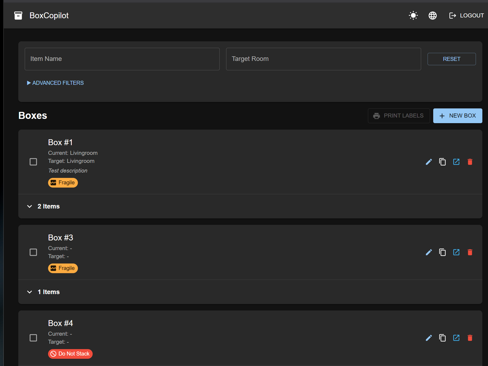
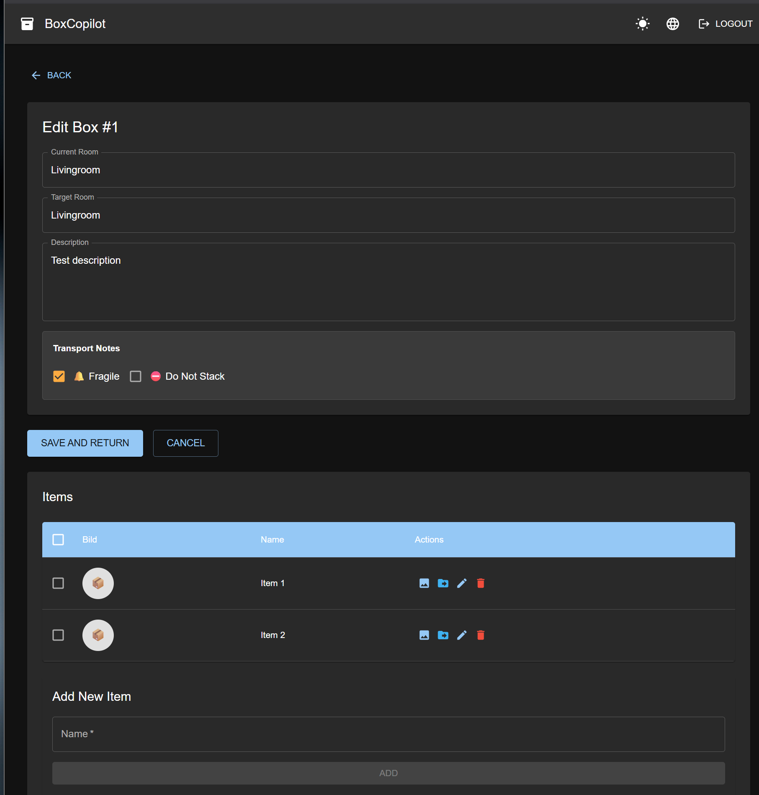
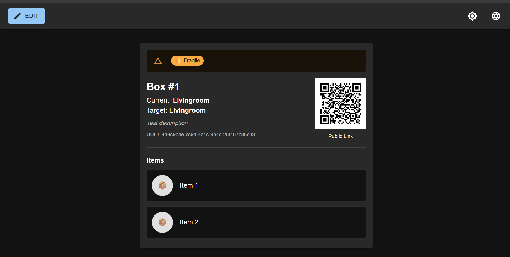
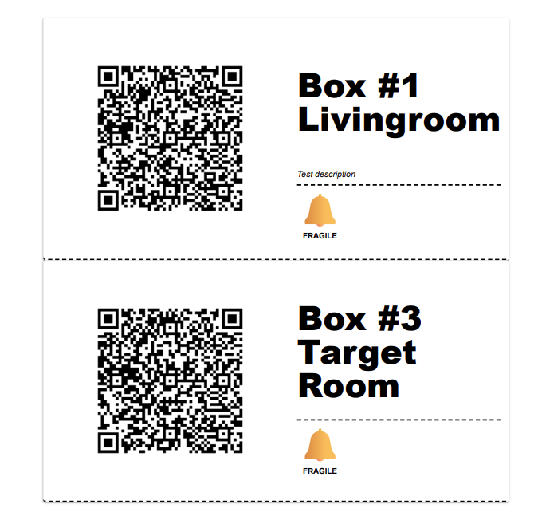

# BoxCopilot

[](https://www.gnu.org/licenses/gpl-3.0)

**Keep your moving organized.** BoxCopilot helps families stay sane during moves by tracking what's packed in each box and where it should go. No more opening 20 boxes to find your coffee maker.


*Main dashboard showing all boxes with search and room filtering*


*Manage box contents and assign rooms*


*Share box contents with family members via QR code - no login required*


*Print labels with QR codes for easy scanning*

## Features

- Boxes
  - Create boxes with current room, target room, description, and handling flags (Fragile, Do not stack).
  - List and filter boxes: search by item name, filter by target room, and optionally show only fragile/no‑stack boxes.
  - Quick actions per box: copy/open public link, edit, delete, and expand to preview items.
  - Public sharing: per‑box UUID public page shows box details and items (no login required). The link can be regenerated per box; the old link and printed QR labels stop working.
  - Label printing: select boxes and generate an A4 PDF (3 labels/page) with QR codes to the public page, target room, and handling badges.

- Items
  - Create, edit, and delete items within a box.
  - Bulk move: move one or many items to another box.
  - Images: add via in‑app camera or gallery, view thumbnail and full‑size preview, and delete images when needed.

- Camera (mobile‑friendly)
  - In‑app camera with front/rear switch, pinch‑to‑zoom, torch/flash when supported, and capture/retake/accept flow.

- Public Preview
  - Read‑only preview at `/public/{uuid}`; ideal for sharing with helpers and family.
  - Item images served via tokenized endpoints with sensible caching for fast loads.

- Admin & Authentication
  - Admin panel to manage users, roles, passwords, and generate magic login links. Setting a user's password ends that user's sessions.
  - Dual authentication: Nextcloud/OIDC and form login; failed form and magic-link logins are throttled per client IP (see [Security](#security)).

- Language
  - Switch between German and English; preference is remembered.

- Claude / MCP integration
  - Optional, read-only [Model Context Protocol](https://modelcontextprotocol.io/) server built into the backend, so Claude can search the inventory on the user's behalf. Off by default (`APP_MCP_ENABLED=false`).
  - Four tools, all read-only: `search_items`, `get_item_image`, `search_boxes`, `get_box_contents`. No box UUIDs, image tokens or write access ever cross this boundary.
  - An admin enables `mcp_allowed` for a user in the Admin Panel. That user then opens the "Claude-Verbindung" dialog (via the app menu), which shows their personal client ID and the `/mcp` connector URL, both one-click copyable.
  - In Claude, add a Custom Connector with that `/mcp` URL. On first use, Claude opens a BoxPilot login/consent screen; after consenting, the connection is active. Each user gets their own client ID, bound to their account: pasting someone else's ID into Claude does not grant access to their data.
  - The dialog also offers "Neu erzeugen" (regenerate the client ID, invalidating the old one) and "Alle Verbindungen widerrufen" (revoke every active connection for that user).
  - Operations, security posture, the kill-switch and environment variables: see [`docs/ops/mcp-server.md`](docs/ops/mcp-server.md).

## Development

### Prerequisites
- Java 21
- Node.js 20+
- Maven 3.9+

### Backend

**Required Environment Variables:**
```powershell
# PowerShell
$env:FRONTEND_URL = 'http://localhost:3000'
$env:CLIENT_ID = 'your-nextcloud-client-id'
$env:CLIENT_SECRET = 'your-nextcloud-client-secret'
$env:NEXTCLOUD_URL = 'https://cloud.example.com'
$env:NEXTCLOUD_LOGOUT_URL = 'https://cloud.example.com/index.php/logout'
$env:SPRING_PROFILES_ACTIVE = 'dev'
```

**Run Backend (Maven ONLY - never execute JAR directly):**
```bash
cd backend
mvn spring-boot:run
```
Runs on port 8080 with H2 file-based database at `./data/boxcopilot-dev`.

**Default Admin User:**  
On first startup, a default admin account is created from `ADMIN_USERNAME` / `ADMIN_PASSWORD`:
- Username: `admin` (default)
- Password: `admin` in the `dev` profile only (override with `ADMIN_PASSWORD`)
- Role: `ADMIN`

**Important:** In the `prod` profile `ADMIN_PASSWORD` has no default. Startup fails if it is empty, `admin` or shorter than 12 characters, or if an existing ADMIN account still has the password `admin`. Passwords set in the Admin Panel are 12 to 128 characters. Set `REDIS_PASSWORD` as well (Redis runs with `requirepass`).

### Frontend
```bash
cd frontend
npm install
npm run dev
```
Runs on port 5173 with Vite dev server. API calls are proxied to `http://localhost:8080`.

### Configuration Profiles
- `dev` - H2 file database, JDBC sessions, OIDC enabled, dual authentication
- `prod` - PostgreSQL, Redis sessions, OIDC enabled, dual authentication
- `test` - H2 in-memory, security disabled for testing

See [application-*.yml](backend/src/main/resources/) for profile configurations.

### API Endpoints

**Authentication:**
- `POST /api/auth/login` - Form-based login (`username` + `password`, form-encoded, with CSRF token); 429 + `Retry-After` when throttled
- `GET /oauth2/authorization/nextcloud` - Initiate OIDC login
- `POST /api/v1/auth/magic-login` - Redeem a magic login link (`{"token": "..."}`); 429 + `Retry-After` when throttled
- `POST /api/auth/logout` - Logout current user; answers 200 with `{"redirectUrl": ...}` (identity provider logout URL for OIDC users, the frontend otherwise) and the SPA navigates there
- `GET /api/v1/me` - Get current user info
- `GET /api/v1/csrf` - Fetch the CSRF token

**Health (no authentication):**
- `GET /actuator/health` - `{"status":"UP"}` or `{"status":"DOWN"}` (503), no details; used by the compose healthcheck

**User Management (ADMIN only):**
- `GET /api/v1/admin/users` - List all users
- `GET /api/v1/admin/users/{id}` - Get one user
- `POST /api/v1/admin/users` - Create new user
- `PUT /api/v1/admin/users/{id}` - Update user
- `PUT /api/v1/admin/users/{id}/password` - Set password (ends that user's sessions, invalidates their magic links, revokes their MCP access)
- `DELETE /api/v1/admin/users/{id}` - Delete user
- `POST /api/v1/admin/users/{id}/magic-link` - Generate magic login link
- `DELETE /api/v1/admin/users/{id}/magic-link` - Invalidate the user's magic links

**Boxes (authenticated):**
- `GET /api/v1/boxes` - List all boxes
- `GET /api/v1/boxes/{uuid}` - Get one box
- `POST /api/v1/boxes` - Create box
- `PUT /api/v1/boxes/{id}` - Update box
- `POST /api/v1/boxes/{id}/rotate-share` - Regenerate the public link and image tokens (old links and printed QR labels stop working)
- `DELETE /api/v1/boxes/{id}` - Delete box (also removes its image files)

**Items (authenticated):**
- `GET /api/v1/items/box/{boxUuid}` - List the items of a box
- `GET /api/v1/items/search` - Search items
- `POST /api/v1/items` - Create item
- `PUT /api/v1/items/{id}` - Update item
- `DELETE /api/v1/items/{id}` - Delete item
- `PUT /api/v1/items/{id}/move` - Move item to another box
- `PUT /api/v1/items/move-bulk` - Move several items to another box
- `POST /api/v1/items/{id}/image` - Upload item image (max 25 megapixels; 400 if not a valid image, 503 + `Retry-After` when busy)
- `DELETE /api/v1/items/{id}/image` - Delete item image

**Public Access (no authentication):**
- `GET /api/v1/public/{uuid}` - Get box preview by UUID
- `GET /api/v1/public/items/{token}/image` - Get item thumbnail
- `GET /api/v1/public/items/{token}/image/large` - Get large item image

**Claude / MCP (only when `APP_MCP_ENABLED=true`):**
- `POST /api/v1/me/mcp-client` - Get (create if missing) the caller's MCP client ID
- `POST /api/v1/me/mcp-client/regenerate` - Replace the client ID, deleting the old one and its connections
- `DELETE /api/v1/me/mcp-connections` - Revoke all of the caller's MCP connections
- `POST /mcp` - MCP endpoint (OAuth 2.1 bearer token required); see [`docs/ops/mcp-server.md`](docs/ops/mcp-server.md)

## Production Deployment

### Prerequisites
- Docker & Docker Compose
- Traefik reverse proxy (must be running externally)
- Nextcloud instance for OIDC authentication

### Setup

1. **Configure environment variables**

Create `.env` file:
```bash
# Database
POSTGRES_USER=boxuser
POSTGRES_PASSWORD=secure-password-here
POSTGRES_DB=boxcopilot

# Redis (sessions) and the bootstrap admin; ADMIN_PASSWORD needs at least 12 characters
REDIS_PASSWORD=generate-with-openssl-rand-base64-24
ADMIN_PASSWORD=generate-with-openssl-rand-base64-24

# URLs (VITE_API_BASE_URL is baked into the frontend bundle at build time)
FRONTEND_URL=https://boxes.example.com
VITE_API_BASE_URL=https://boxes-api.example.com

# OAuth2/OIDC (Nextcloud)
CLIENT_ID=your-nextcloud-oauth-client-id
CLIENT_SECRET=your-nextcloud-oauth-client-secret
NEXTCLOUD_URL=https://cloud.example.com
NEXTCLOUD_LOGOUT_URL=https://cloud.example.com/index.php/logout

# Traefik Hosts
TRAEFIK_FRONTEND_HOST=boxes.example.com
TRAEFIK_BACKEND_HOST=boxes-api.example.com
```

[`.env.example`](.env.example) lists every variable, including the optional ones (login throttling, session cookie
`SameSite`, CSP/HSTS, upload concurrency, MCP). In `prod` the backend lists all missing required variables in one
startup message.

2. **Prepare the data directories** (the backend runs as non-root uid 10001; once, for both `logs` and `images`, before the first start. Without it the container exits: the log shows `Permission denied` for `/app/logs/boxcopilot.log` or the image directory error)
```bash
mkdir -p logs images && sudo chown -R 10001:10001 logs images
```

3. **Start services**
```bash
docker compose up -d
```

Health: `docker compose ps` shows the backend as healthy once `GET /actuator/health` reports `UP`; the frontend starts after it.

Back up the database and the `images` directory together: [`docs/ops/backup-restore.md`](docs/ops/backup-restore.md).

### Security

- **Login throttling.** Failed logins are counted per client IP and per IP + username. By default an IP may fail 10 logins
  in 15 minutes and one IP + username pair 5 (`APP_LOGIN_THROTTLE_IP_LIMIT`, `APP_LOGIN_THROTTLE_IP_USER_LIMIT`,
  `APP_LOGIN_THROTTLE_WINDOW`). After that `POST /api/auth/login` and `POST /api/v1/auth/magic-login` answer **429** with a
  `Retry-After` header, before any password check; failed magic-link redemptions count against the IP only. A blocked IP
  cannot log in even with the correct password until the window ends, so people behind one shared address (NAT) share the
  quota. Accounts are never locked, so nobody can lock someone else out by guessing their username.
- **In-process, one replica.** The counters live in the backend process: they reset on restart and are not shared between
  replicas. Run a single backend replica.
- **`TRUSTED_PROXY_PATTERN` must be right.** The client IP comes from `X-Forwarded-For`, which Tomcat trusts only from
  addresses matching this Java regular expression (not CIDR). The default covers private ranges and loopback; a blank
  value is treated like an unset one, and the backend logs the pattern in effect at startup (`Trusted proxy pattern
  (default|custom from TRUSTED_PROXY_PATTERN): ...`). If your proxy is outside the range, or the pattern is wrong, all
  clients appear as the proxy and share one login throttle counter, so a few failed logins block everybody.
- **Password reset ends sessions.** Setting a user's password in the Admin Panel ends all of that user's sessions, invalidates
  their magic links and revokes their MCP access. Resetting your own password logs you out. The session holds no password
  hash. Every authenticated request re-reads the user from the database to check that the session is still valid.
- **Session cookie.** `SESSION_COOKIE_SAME_SITE` defaults to `none` (needed when the SPA runs on another site than the API).
  Set `lax` when frontend and API share a site, e.g. `app.example.com` and `api.example.com`; `strict` breaks the OIDC
  redirect back to the backend.
- **Frontend headers.** The frontend nginx sends `Content-Security-Policy` (report-only by default, `CSP_MODE=enforce` to
  enforce; verified with the browser suite in both modes, switch after watching the browser console for the first
  days), `Strict-Transport-Security` (`HSTS_ENABLED`, on by default in `docker-compose.yml`, set `false` for plain http),
  `X-Frame-Options: DENY`, `X-Content-Type-Options: nosniff` and `Referrer-Policy: no-referrer`. The CSP allows the
  origin of `VITE_API_BASE_URL` (derived automatically as `API_ORIGIN`).
- **Containers.** The backend runs as uid 10001 with a read-only root filesystem, no extra capabilities and a memory limit;
  postgres and the frontend do not receive the application secrets they do not need.
- **Uploads.** Images are limited to 25 megapixels, only a few are decoded at once (`APP_IMAGE_MAX_CONCURRENT_UPLOADS`,
  default 2), and the backend refuses to start if the image directory is not writable.
- **MCP.** With `APP_MCP_ENABLED=true` the backend refuses to start unless `VITE_API_BASE_URL` and `BACKEND_URL` have the
  same origin. See [`docs/ops/mcp-server.md`](docs/ops/mcp-server.md).

### Upgrading to 0.2.0

Read [`docs/releases/0.2.0.md`](docs/releases/0.2.0.md) first. It lists the upgrade steps in order (backup, `ADMIN_PASSWORD`
of at least 12 characters, `chown` for the non-root backend, `TRUSTED_PROXY_PATTERN`, new variables, everyone signs in
again, switching the CSP from report-only to enforce), the migrations V15 and V16, and the rollback procedure.

### Upgrading from the Spring Boot 3.5 build

The backend now runs on Spring Boot 4.1 (Spring Framework 7, Spring Security 7, Hibernate 7, Jackson 3, Spring AI 2).
Spring Boot 3.5 open-source support ended on 2026-06-30; 4.1.x is supported until 2027-07-31 (endoflife.date). The
upgrade was rehearsed against a dump of a 3.5 installation (see `docs/superpowers/plans/artifacts/verification-boot4.md`).

**Before you upgrade**
- Take a database dump, e.g. `docker exec boxcopilot-postgres pg_dump -U <POSTGRES_USER> <POSTGRES_DB> > boxpilot-3.5.sql`.
  The upgrade adds no Flyway migration (the schema stays at V14) and Flyway reports "up to date", so the dump is only
  needed if you want to discard data written by 4.1 later.
- The backend has a healthcheck on `GET /actuator/health` (`start_period` 120s) and the frontend waits for it to be healthy
  (`depends_on: condition: service_healthy`). If the backend never becomes healthy, `docker compose up -d` reports the
  failed dependency and the frontend stays down.
- The backend image sets `JAVA_TOOL_OPTIONS=-XX:MaxRAMPercentage=75`, which raises the heap ceiling from the JVM
  default (25%) to 75% of the memory the container sees. The compose file sets `mem_limit: 1g` for the backend; if you
  raise or remove it, adjust the percentage.
- Postgres is now pinned to `postgres:15.19` (Debian 13 / trixie); the previous `postgres:15` was already a moving
  tag. Before upgrading run `docker exec boxcopilot-postgres cat /etc/os-release`. If the running image is Debian 12
  (bookworm), either pin `postgres:15.19-bookworm` or `REINDEX` your text indexes after the swap (glibc collation
  changes).
- *Non-root backend:* since 0.2.0 the backend runs as uid/gid 10001 with a read-only root filesystem. See the
  [0.2.0 release notes](docs/releases/0.2.0.md) for the one-time `chown` of `logs` and `images` and how to go back to root.

**What carries over unchanged**
- Users usually stay logged in: Redis sessions written by 3.5 are normally still read by 4.1. A stored session value
  that 4.1 cannot deserialize (Spring Security 6 vs 7 class differences) is treated as no session: the request is
  anonymous (401 / login page), the user signs in again, and one WARN is logged per backend start. It is never a 500.
- MCP access and refresh tokens issued by 3.5 stay valid, and so do unredeemed magic links.
- `Box.description` is still stored as a PostgreSQL large object (the column holds the OID as text), exactly as before.

**What changes**
- JSON object keys in REST and MCP response bodies are now in alphabetical order (Jackson 3 default). The order has no
  meaning and the frontend reads by key, but anything that compares response text byte for byte will see a difference.
  The MCP `tools/list` schemas also gain a `$schema` entry; tool names are unchanged.
- Cookies that the server clears (`XSRF-TOKEN`, `JSESSIONID`) carry `Expires=Thu, 01 Jan 1970 ...` but no longer
  `Max-Age=0` (Tomcat 11). Browsers still delete them.
- The `/mcp` Host/Origin check is derived from `BACKEND_URL`. The `Host` header must equal the host (and port, if
  `BACKEND_URL` names one) of `BACKEND_URL`, otherwise the answer is 421. An `Origin` header, if present, must equal
  the origin of `BACKEND_URL`, otherwise 403; clients that send no `Origin` pass. A default port in
  `BACKEND_URL` (`:443` for https, `:80` for http) is ignored for this check, since clients send `Host` without
  it; a non-default port must appear in `Host`. Traefik must pass the original `Host` through.
- `APP_MCP_ENABLED` is the only MCP master switch. `SPRING_AI_MCP_SERVER_ENABLED=true` on its own no longer
  enables anything while `APP_MCP_ENABLED` is not `true`.
- Sessions expire 30 minutes after last use (1800 s, set by `@EnableRedisHttpSession` in `RedisConfig`). The dead
  `spring.session.timeout: 122400s` key was removed from `application-prod.yml`; the effective lifetime is unchanged.

#### Rolling back to the 3.5 build

1. Stop the 4.1 backend (`docker compose stop backend`), so it cannot write new sessions.
2. Delete the Redis session keys. Spring Security 7 stores a `FactorGrantedAuthority` in every session; Boot 3.5
   cannot deserialize it and answers **500 on every request that carries a session cookie written by 4.1**
   (`ClassNotFoundException ... FactorGrantedAuthority`) until that session expires (at most 30 minutes after its
   last use) or is removed. With the compose
   file's Redis (it sets `REDISCLI_AUTH` from `REDIS_PASSWORD`, so `redis-cli` inside the container authenticates):
   ```bash
   docker exec boxcopilot-redis sh -c "redis-cli --scan --pattern 'spring:session:*' | xargs -r redis-cli del"
   ```
   Afterwards the stale cookies are treated as anonymous and users log in again.
3. Start the previous (3.5) backend and frontend images.
4. Data written by 4.1 (descriptions, items, images, MCP authorizations, magic links) is readable by 3.5, so the
   dump does not need to be restored. Restore it only if you want to discard everything written since the upgrade.

#### Known issues (not caused by the migration)

Found during the Boot 4 verification; each also occurs on the 3.5 build, except where noted. Rejected uploads no longer remove the stored image, and over-size uploads and wrong content types get a 4xx since 0.2.0.
- A missing request parameter or a missing multipart part is answered with 500 by the catch-all handler instead of a 4xx.
- Redeeming a magic link can race the SPA's own `/api/v1/me` call for the `XSRF-TOKEN` cookie, so a valid link can
  show "invalid" without being consumed; loading the link again normally works. In testing this happened more often
  on 4.1 (7 of 8 cold loads) than on 3.5 (4 of 8).
- The public image URL of an item whose image was deleted answers 500 instead of 404.
- MCP tool calls with arguments of the wrong type (e.g. a string for a number) return the library's raw message and
  write no audit line. Missing or out-of-range arguments are handled and audited.
- The frontend base image `nginx:1.30-alpine` showed OS-package CVEs in `docker scout` at test time (8 critical,
  18 high: curl, brotli, libxml2). Consider rebuilding on a newer base; the backend image showed none.

### Nextcloud OIDC Setup

Register OAuth2/OIDC client in Nextcloud:
- **Redirect URI**: `https://boxes-api.example.com/login/oauth2/code/nextcloud`
- **Grant Type**: Authorization Code
- **Scopes**: `openid`, `profile`, `email`

Use the generated `client_id` and `client_secret` in your `.env` file.

### Reverse Proxy (Traefik)

**Important:** BoxCopilot requires Traefik to be running **externally** before starting the application. The services connect to an existing Traefik instance via the `traefik-proxy` Docker network.

#### Complete Traefik Setup Example

If you don't have Traefik running yet, create a separate `traefik-compose.yml`:

```yaml
version: '3.8'

services:
  traefik:
    image: traefik:v2.10
    container_name: traefik
    restart: unless-stopped
    security_opt:
      - no-new-privileges:true
    networks:
      - traefik-proxy
    ports:
      - "80:80"
      - "443:443"
    environment:
      - CLOUDFLARE_EMAIL=${CLOUDFLARE_EMAIL}     # Optional: for DNS challenge
      - CLOUDFLARE_API_KEY=${CLOUDFLARE_API_KEY}   # Optional: for DNS challenge
    volumes:
      - /etc/localtime:/etc/localtime:ro
      - /var/run/docker.sock:/var/run/docker.sock:ro
      - ./traefik/traefik.yml:/traefik.yml:ro
      - ./traefik/acme.json:/acme.json
      - ./traefik/config.yml:/config.yml:ro
    labels:
      - "traefik.enable=true"
      - "traefik.http.routers.traefik.entrypoints=http"
      - "traefik.http.routers.traefik.rule=Host(`traefik.example.com`)"
      - "traefik.http.middlewares.traefik-https-redirect.redirectscheme.scheme=https"
      - "traefik.http.middlewares.sslheader.headers.customrequestheaders.X-Forwarded-Proto=https"
      - "traefik.http.routers.traefik.middlewares=traefik-https-redirect"
      - "traefik.http.routers.traefik-secure.entrypoints=https"
      - "traefik.http.routers.traefik-secure.rule=Host(`traefik.example.com`)"
      - "traefik.http.routers.traefik-secure.tls=true"
      - "traefik.http.routers.traefik-secure.tls.certresolver=http"
      - "traefik.http.routers.traefik-secure.service=api@internal"

networks:
  traefik-proxy:
    # fixed name: BoxCopilot's docker-compose.yml joins this network as external "traefik-proxy"
    name: traefik-proxy
```

The `traefik.example.com` dashboard router above has no authentication middleware. Remove it (and `api.dashboard`) or protect it before exposing Traefik to the internet.

Create `traefik/traefik.yml`:
```yaml
api:
  dashboard: true
  debug: true

entryPoints:
  http:
    address: ":80"
    http:
      redirections:
        entryPoint:
          to: https
          scheme: https
  https:
    address: ":443"

serversTransport:
  insecureSkipVerify: true

providers:
  docker:
    endpoint: "unix:///var/run/docker.sock"
    exposedByDefault: false
  file:
    filename: /config.yml

certificatesResolvers:
  # The name must match the tls.certresolver label in docker-compose.yml ("http").
  http:
    acme:
      email: your-email@example.com
      storage: acme.json
      # Use HTTP challenge for Let's Encrypt:
      # httpChallenge:
      #   entryPoint: http
      # Or DNS challenge (example with Cloudflare):
      dnsChallenge:
        provider: cloudflare
        resolvers:
          - "1.1.1.1:53"
          - "1.0.0.1:53"
```

Create empty `traefik/acme.json` with correct permissions:
```bash
mkdir -p traefik
touch traefik/acme.json
chmod 600 traefik/acme.json
```

Start Traefik:
```bash
docker-compose -f traefik-compose.yml up -d
```

Verify the `traefik-proxy` network exists:
```bash
docker network ls | grep traefik-proxy
```

Then start BoxCopilot services with the main `docker-compose.yml`.

#### Network Configuration

BoxCopilot's `docker-compose.yml` connects to the external `traefik-proxy` network:
```yaml
networks:
  traefik-proxy:
    external: true
```

Both frontend and backend services include Traefik labels (certificate resolver `http`, entrypoints `http` and `https`) for:
- HTTP → HTTPS redirect
- TLS certificate provisioning (Let's Encrypt)
- Host-based routing

Traefik forwards `X-Forwarded-For`; the backend uses it for login throttling only for requests that arrive from an address matching `TRUSTED_PROXY_PATTERN` (default: private ranges and loopback, which covers the compose network). Check the pattern if Traefik runs on a different network, see [Security](#security).

## Technology Stack

**Backend:** Java 21, Spring Boot 4.1, Spring Security with OAuth2/OIDC, Spring Data JPA, PostgreSQL, Redis, Flyway

**Frontend:** React 19, TypeScript, Vite, Material-UI, Axios, React Router

**Infrastructure:** Docker, Docker Compose, Traefik, PostgreSQL 15, Redis

## License

This project is licensed under the **GNU General Public License v3.0 (GPL-3.0)**.

**You are free to:**
- ✅ **Use** - Run the program for any purpose
- ✅ **Study** - Access and study the source code
- ✅ **Share** - Copy and distribute the software
- ✅ **Modify** - Make changes and improvements to the software

**Under the following terms:**
- 📝 **Copyleft** - If you distribute modified versions, you must also license them under GPL v3.0
- 🔓 **Source Code** - You must make the source code available when you distribute the software
- 📄 **License Notice** - You must include a copy of the GPL v3.0 license and copyright notice
- 🔄 **Same License** - All derivative works must be licensed under the same GPL v3.0 terms

This ensures that BoxCopilot and all its derivatives remain free and open source software forever.

See [LICENSE](LICENSE) for full details or visit https://www.gnu.org/licenses/gpl-3.0.html
