# BoxCopilot

[](https://www.gnu.org/licenses/gpl-3.0)

**Keep your move organized.** BoxCopilot tracks what is packed in each moving box and where it has to go. Label every box with a QR code, let helpers scan it without an account, and find the coffee maker without opening 20 boxes.

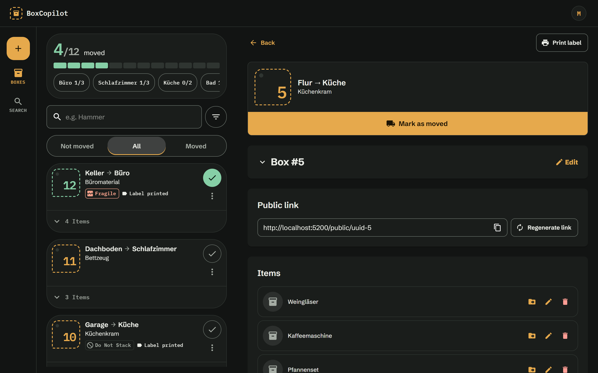

## Contents

- [Tour](#tour)
- [Features](#features)
- [Quick start (development)](#quick-start-development)
- [Configuration](#configuration)
- [API](#api)
- [Production deployment](#production-deployment)
- [Security](#security)
- [Upgrading](#upgrading)
- [Testing](#testing)
- [Further documentation](#further-documentation)
- [Technology stack](#technology-stack)
- [License](#license)

## Tour

### Sign in

Local username/password login and Nextcloud (OIDC) login. Admins can also hand out one-time magic links.

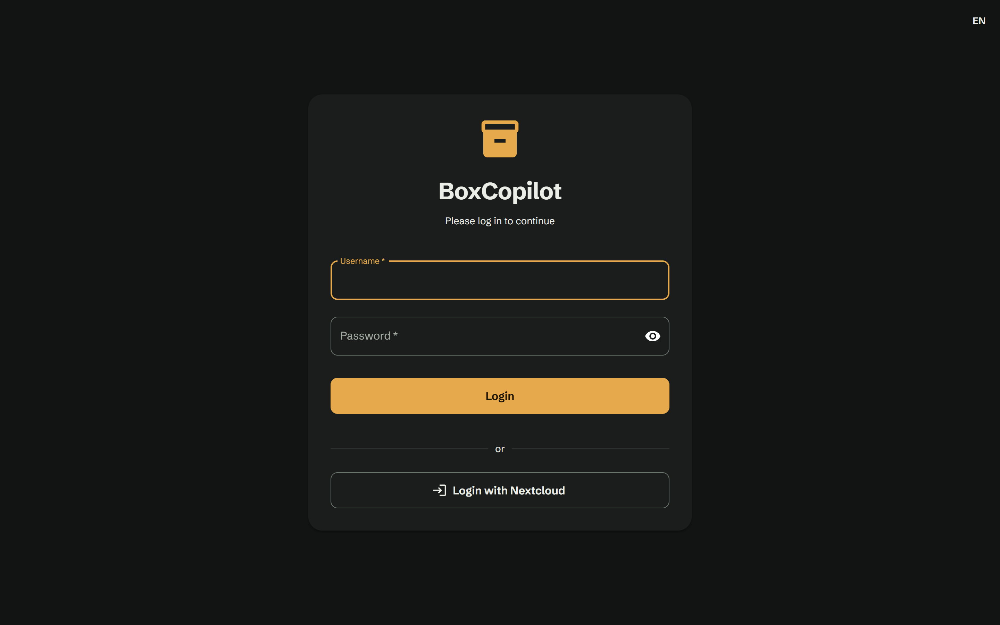

### Boxes at a glance

The dashboard lists all boxes with current room, target room, description and handling badges (Fragile, Do not stack). Expand a box to preview its items with photos. Select several boxes for bulk updates or label printing.

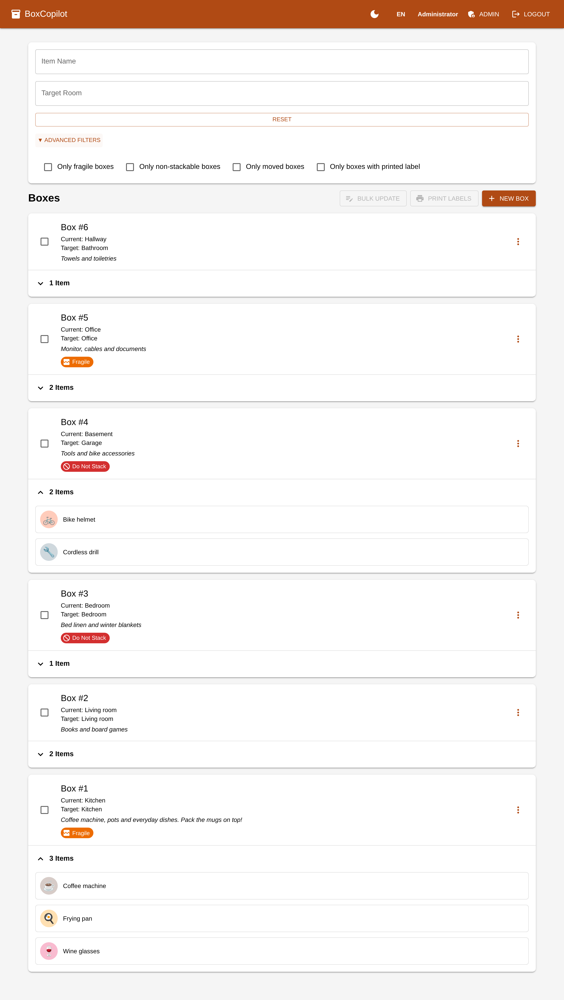

Search by item name, filter by target room and, under *Advanced filters*, by fragile, non-stackable, moved or label-printed boxes.

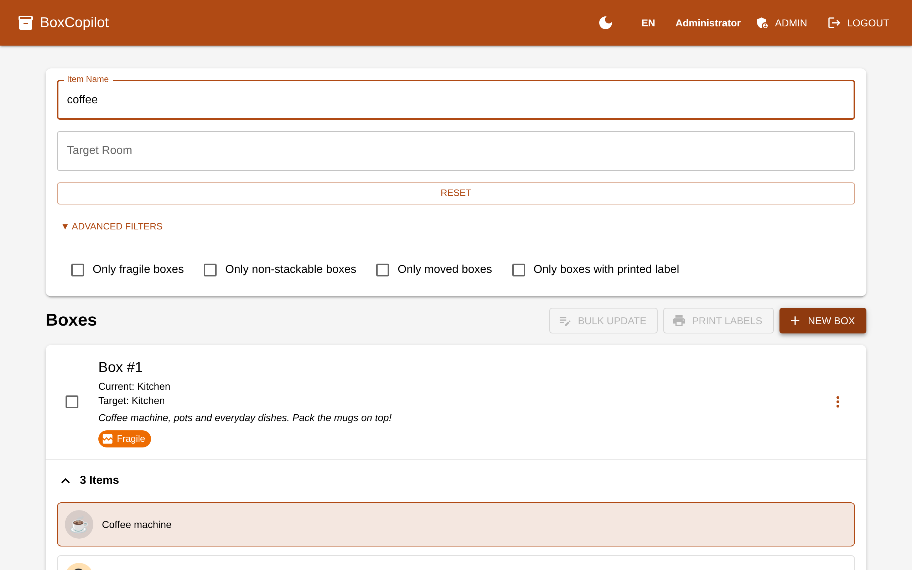

### Create and edit boxes

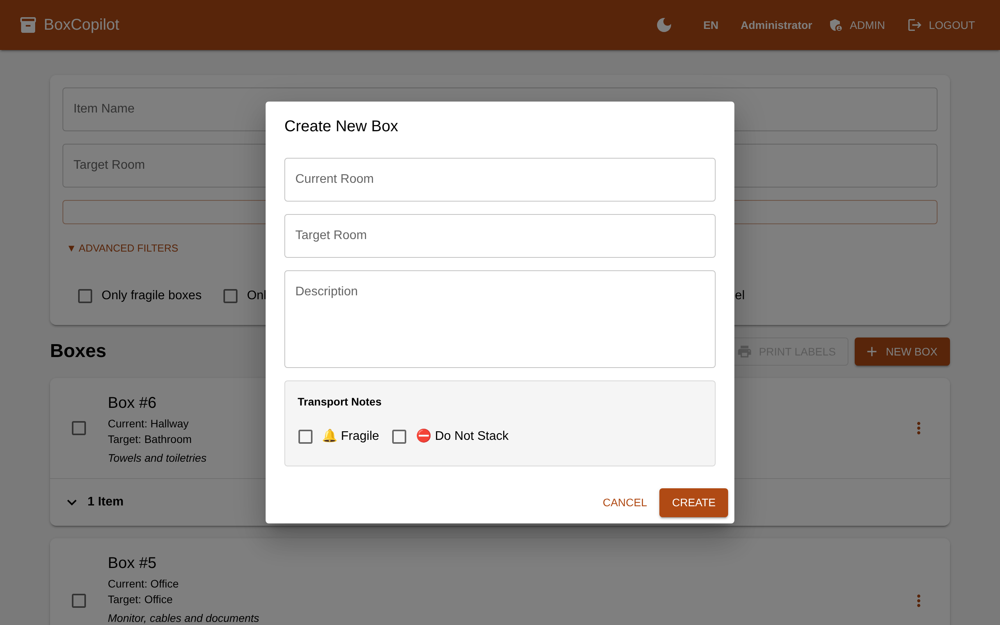

The box page edits room, description, transport notes and status, shows the public link (regenerable) and lists the items. Items can be edited, moved to another box or deleted.

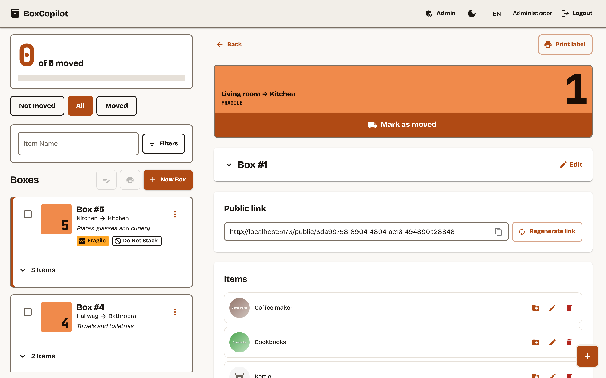

### Add items with photos

Add an item by name and attach a photo from the in-app camera or the gallery. *Save and next* keeps the dialog open for the next item.

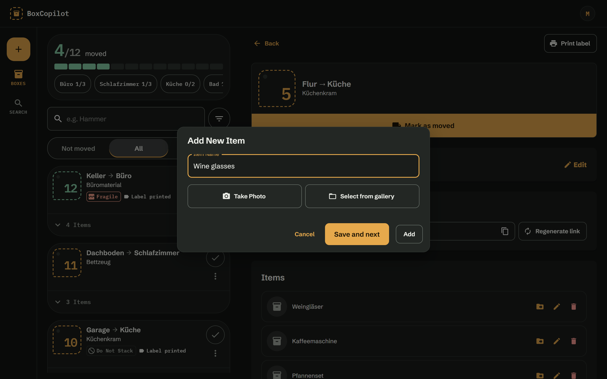

### Labels with QR codes

Select boxes and print labels. The result is an A4 PDF with three labels per page: box number, handling badges, target room, description and a QR code that points to the public page.

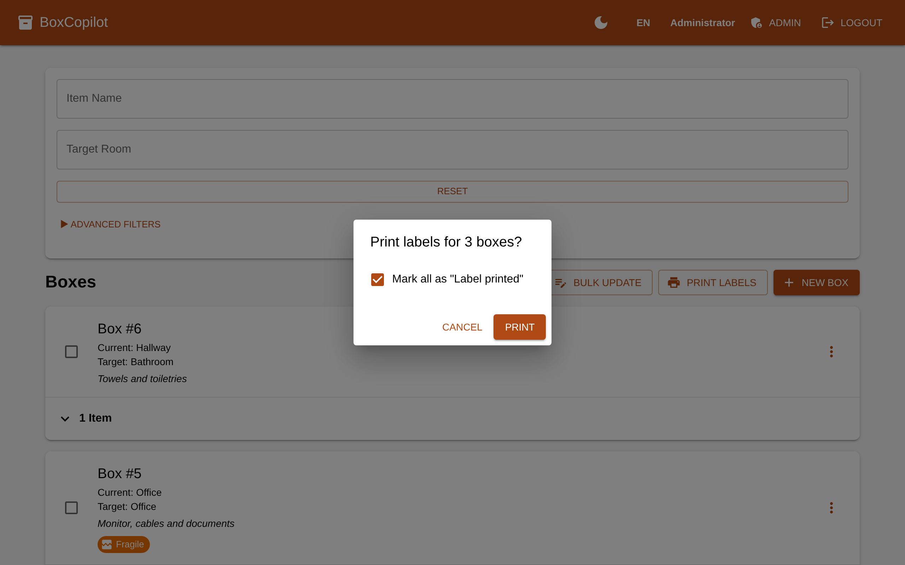


### Public preview (no login)

Scanning the QR code opens a read-only page with the box content and photos. Rotating the link in the box page invalidates the old link and every printed label.

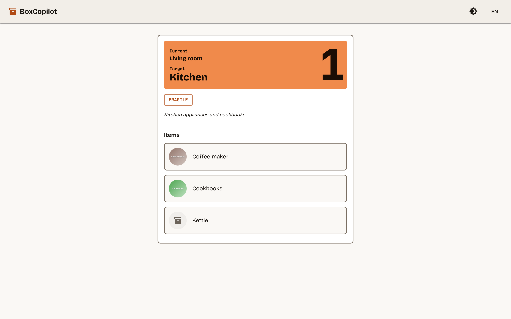

### Administration

Manage users, roles, passwords and magic links.

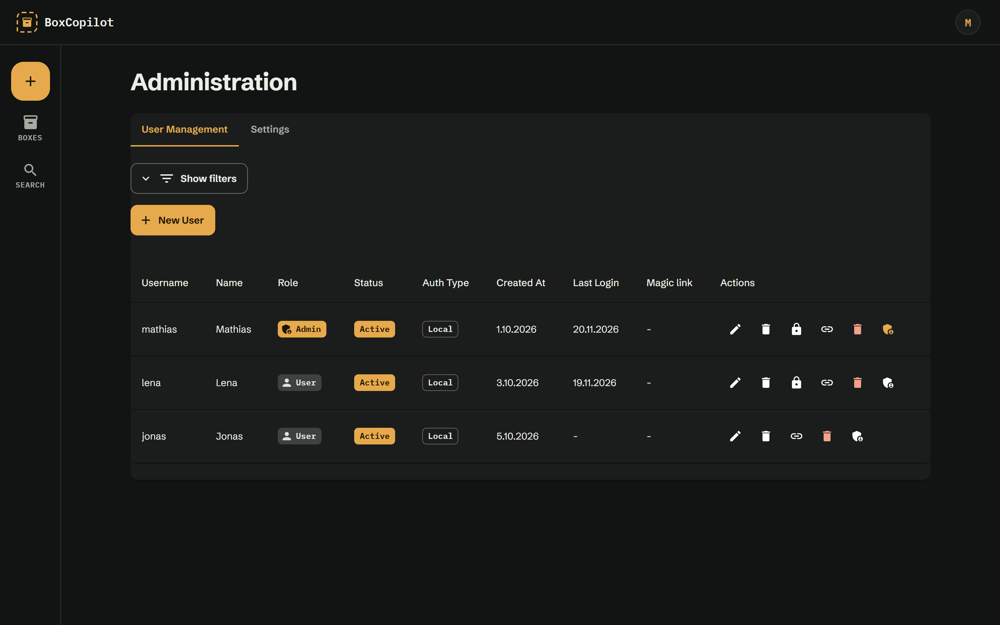

### Mobile and dark mode

The UI is responsive and offers a dark theme. German and English are built in.

<p>
  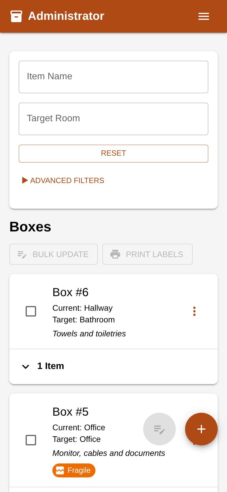
  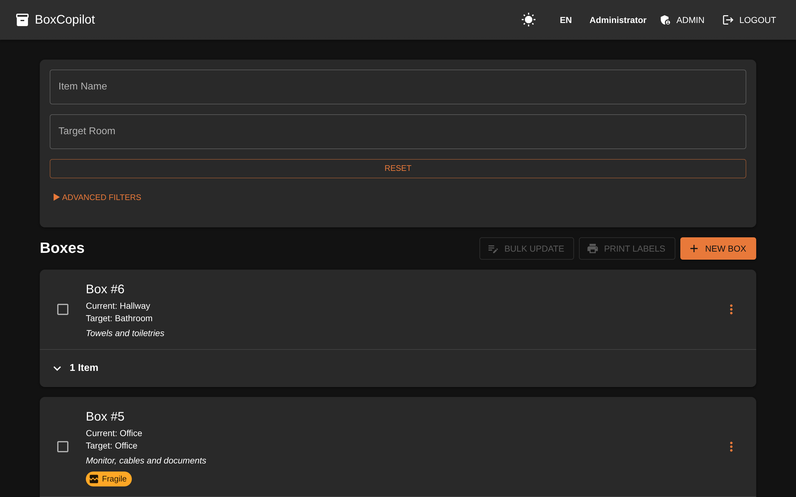
</p>

## Features

- Boxes
  - Create boxes with current room, target room, description, and handling flags (Fragile, Do not stack).
  - List and filter boxes: search by item name, filter by target room, and optionally show only fragile/no‑stack boxes.
  - Quick actions per box: copy/open public link, edit, delete, and expand to preview items.
  - Public sharing: per‑box UUID public page shows box details and items (no login required). The link can be regenerated per box; the old link and printed QR labels stop working.
  - Label printing: select boxes and generate an A4 PDF (3 labels/page) with QR codes to the public page, target room, and handling badges.

- Items
  - Create, edit, and delete items within a box.
  - Bulk move: move one or many items to another box.
  - Images: add via in‑app camera or gallery, view thumbnail and full‑size preview, and delete images when needed.

- Camera (mobile‑friendly)
  - In‑app camera with front/rear switch, pinch‑to‑zoom, torch/flash when supported, and capture/retake/accept flow.

- Public Preview
  - Read‑only preview at `/public/{uuid}`; ideal for sharing with helpers and family.
  - Item images served via tokenized endpoints with sensible caching for fast loads.

- Admin & Authentication
  - Admin panel to manage users, roles, passwords, and generate magic login links. Setting a user's password ends that user's sessions.
  - Dual authentication: Nextcloud/OIDC and form login; failed form and magic-link logins are throttled per client IP (see [Security](#security)).

- Language
  - Switch between German and English; preference is remembered.

- Claude / MCP integration
  - Optional, read-only [Model Context Protocol](https://modelcontextprotocol.io/) server built into the backend, so Claude can search the inventory on the user's behalf. Off by default (`APP_MCP_ENABLED=false`).
  - Four tools, all read-only: `search_items`, `get_item_image`, `search_boxes`, `get_box_contents`. No box UUIDs, image tokens or write access ever cross this boundary.
  - An admin enables `mcp_allowed` for a user in the Admin Panel. That user then opens the "Claude-Verbindung" dialog (via the app menu), which shows their personal client ID and the `/mcp` connector URL, both one-click copyable.
  - In Claude, add a Custom Connector with that `/mcp` URL. On first use, Claude opens a BoxPilot login/consent screen; after consenting, the connection is active. Each user gets their own client ID, bound to their account: pasting someone else's ID into Claude does not grant access to their data.
  - The dialog also offers "Neu erzeugen" (regenerate the client ID, invalidating the old one) and "Alle Verbindungen widerrufen" (revoke every active connection for that user).
  - Operations, security posture, the kill-switch and environment variables: see [`docs/ops/mcp-server.md`](docs/ops/mcp-server.md).

## Quick start (development)

### Prerequisites
- Java 21
- Node.js 20+ (22 works)
- Maven 3.9+

The `dev` profile uses a file-based H2 database and JDBC sessions; no PostgreSQL or Redis is needed.

### 1. Backend

The backend resolves the OIDC issuer on startup, so `NEXTCLOUD_URL` must point to a reachable OIDC provider
(a real Nextcloud or a mock, see [Testing](#testing)).

```bash
cd backend
export SPRING_PROFILES_ACTIVE=dev
export APP_URL=http://localhost:5173   # origin the browser uses (the Vite dev server below)
export CLIENT_ID=your-client-id CLIENT_SECRET=your-client-secret
export NEXTCLOUD_URL=https://cloud.example.com
export NEXTCLOUD_LOGOUT_URL=https://cloud.example.com/index.php/logout
mvn spring-boot:run
```

Runs on port 8080. Run it with Maven, not as a JAR. Data goes to `./data/boxcopilot-dev`.

**Default admin.** On first start an admin is created from `ADMIN_USERNAME` / `ADMIN_PASSWORD`:
username `admin`, password `admin` (dev profile only), role `ADMIN`.
In `prod`, `ADMIN_PASSWORD` has no default: startup fails if it is empty, `admin` or shorter than 12 characters,
or if an existing ADMIN account still has the password `admin`. Set `REDIS_PASSWORD` as well.

### 2. Frontend

```bash
cd frontend
npm install
npm run dev
```

Runs on http://localhost:5173. The SPA uses relative URLs only; the Vite dev server proxies `/api`, `/oauth2`, `/login`,
`/mcp` and `/.well-known` to the backend on port 8080, so the browser sees one origin, as in production.

Open http://localhost:5173 and sign in with `admin` / `admin`.

### Configuration profiles

- `dev`: H2 file database, JDBC sessions, OIDC enabled, dual authentication
- `prod`: PostgreSQL, Redis sessions, OIDC enabled, dual authentication
- `test`: H2 in-memory, security disabled for testing

See [application-*.yml](backend/src/main/resources/) for the profile settings and [`.env.example`](.env.example) for every environment variable.

## Configuration

| Variable | Purpose |
|---|---|
| `SPRING_PROFILES_ACTIVE` | `dev` or `prod` |
| `APP_URL` | Public origin of the application (`https://host[:port]`, no path, no trailing slash): OAuth redirect URI, magic links, logout redirect, MCP issuer |
| `CLIENT_ID`, `CLIENT_SECRET` | OAuth2/OIDC client of your Nextcloud |
| `NEXTCLOUD_URL`, `NEXTCLOUD_LOGOUT_URL` | OIDC issuer and logout URL |
| `ADMIN_USERNAME`, `ADMIN_PASSWORD` | Bootstrap admin (`prod`: at least 12 characters) |
| `POSTGRES_*`, `REDIS_PASSWORD` | Database and session store (`prod`) |
| `CSP_MODE` | `enforce` (default) or `report` (Content-Security-Policy-Report-Only, for debugging) |
| `HSTS_ENABLED` | Send `Strict-Transport-Security` (`false` in the app, `true` in `docker-compose.yml`) |
| `TRUSTED_PROXY_PATTERN` | Java regex of the reverse proxies whose `X-Forwarded-*` headers are trusted (`prod`) |
| `TRAEFIK_HOST` | Host of the Traefik router in `docker-compose.yml` (the host of `APP_URL`) |
| `APP_MCP_ENABLED` | Claude / MCP server, off by default |

All other options (login throttling, cookie `SameSite`, CSP/HSTS, upload concurrency, MCP) are listed in [`.env.example`](.env.example).


## API

**Authentication:**
- `POST /api/auth/login` - Form-based login (`username` + `password`, form-encoded, with CSRF token); 429 + `Retry-After` when throttled
- `GET /oauth2/authorization/nextcloud` - Initiate OIDC login
- `POST /api/v1/auth/magic-login` - Redeem a magic login link (`{"token": "..."}`); 429 + `Retry-After` when throttled
- `POST /api/auth/logout` - Logout current user; answers 200 with `{"redirectUrl": ...}` (identity provider logout URL for OIDC users, `APP_URL` otherwise) and the SPA navigates there
- `GET /api/v1/me` - Get current user info
- `GET /api/v1/csrf` - Fetch the CSRF token

**Health (no authentication):**
- `GET /actuator/health` - `{"status":"UP"}` or `{"status":"DOWN"}` (503), no details; used by the compose healthcheck

**User Management (ADMIN only):**
- `GET /api/v1/admin/users` - List all users
- `GET /api/v1/admin/users/{id}` - Get one user
- `POST /api/v1/admin/users` - Create new user
- `PUT /api/v1/admin/users/{id}` - Update user
- `PUT /api/v1/admin/users/{id}/password` - Set password (ends that user's sessions, invalidates their magic links, revokes their MCP access)
- `DELETE /api/v1/admin/users/{id}` - Delete user
- `POST /api/v1/admin/users/{id}/magic-link` - Generate magic login link
- `DELETE /api/v1/admin/users/{id}/magic-link` - Invalidate the user's magic links

**Boxes (authenticated):**
- `GET /api/v1/boxes` - List all boxes
- `GET /api/v1/boxes/{uuid}` - Get one box
- `POST /api/v1/boxes` - Create box
- `PUT /api/v1/boxes/{id}` - Update box
- `POST /api/v1/boxes/{id}/rotate-share` - Regenerate the public link and image tokens (old links and printed QR labels stop working)
- `DELETE /api/v1/boxes/{id}` - Delete box (also removes its image files)

**Items (authenticated):**
- `GET /api/v1/items/box/{boxUuid}` - List the items of a box
- `GET /api/v1/items/search` - Search items
- `POST /api/v1/items` - Create item
- `PUT /api/v1/items/{id}` - Update item
- `DELETE /api/v1/items/{id}` - Delete item
- `PUT /api/v1/items/{id}/move` - Move item to another box
- `PUT /api/v1/items/move-bulk` - Move several items to another box
- `POST /api/v1/items/{id}/image` - Upload item image (max 25 megapixels; 400 if not a valid image, 503 + `Retry-After` when busy)
- `DELETE /api/v1/items/{id}/image` - Delete item image

**Public Access (no authentication):**
- `GET /api/v1/public/{uuid}` - Get box preview by UUID
- `GET /api/v1/public/items/{token}/image` - Get item thumbnail
- `GET /api/v1/public/items/{token}/image/large` - Get large item image

**Claude / MCP (only when `APP_MCP_ENABLED=true`):**
- `POST /api/v1/me/mcp-client` - Get (create if missing) the caller's MCP client ID
- `POST /api/v1/me/mcp-client/regenerate` - Replace the client ID, deleting the old one and its connections
- `DELETE /api/v1/me/mcp-connections` - Revoke all of the caller's MCP connections
- `POST /mcp` - MCP endpoint (OAuth 2.1 bearer token required); see [`docs/ops/mcp-server.md`](docs/ops/mcp-server.md)


## Production deployment

### Prerequisites
- Docker & Docker Compose
- Traefik reverse proxy (must be running externally)
- Nextcloud instance for OIDC authentication

### Setup

1. **Configure environment variables**

Create `.env` file:
```bash
# Database
POSTGRES_USER=boxuser
POSTGRES_PASSWORD=secure-password-here
POSTGRES_DB=boxcopilot

# Redis (sessions) and the bootstrap admin; ADMIN_PASSWORD needs at least 12 characters
REDIS_PASSWORD=generate-with-openssl-rand-base64-24
ADMIN_PASSWORD=generate-with-openssl-rand-base64-24

# Public origin: SPA, API, OAuth callback and MCP share it
APP_URL=https://boxes.example.com

# OAuth2/OIDC (Nextcloud)
CLIENT_ID=your-nextcloud-oauth-client-id
CLIENT_SECRET=your-nextcloud-oauth-client-secret
NEXTCLOUD_URL=https://cloud.example.com
NEXTCLOUD_LOGOUT_URL=https://cloud.example.com/index.php/logout

# Traefik host (the host of APP_URL)
TRAEFIK_HOST=boxes.example.com
```

[`.env.example`](.env.example) lists every variable, including the optional ones (login throttling, session cookie
`SameSite`, CSP/HSTS, upload concurrency, MCP). In `prod` the backend lists all missing required variables in one
startup message.

The image is built from the root [`Dockerfile`](Dockerfile): it builds the frontend with Node, copies the bundle into
the Spring Boot jar and runs it on a JRE as uid 10001. There is one application container (`app`); Spring Boot serves
the SPA, the API, the OAuth endpoints and `/mcp` on port 8080.

2. **Prepare the data directories** (the app runs as non-root uid 10001; once, for both `logs` and `images`, before the first start. Without it the container exits: the log shows `Permission denied` for `/app/logs/boxcopilot.log` or the image directory error)
```bash
mkdir -p logs images && sudo chown -R 10001:10001 logs images
```

3. **Start services**
```bash
docker compose up -d --build
```

Health: `docker compose ps` shows `app` as healthy once `GET /actuator/health` reports `UP`.

Back up the database and the `images` directory together: [`docs/ops/backup-restore.md`](docs/ops/backup-restore.md).

### Nextcloud OIDC setup

Register OAuth2/OIDC client in Nextcloud:
- **Redirect URI**: `https://boxes.example.com/login/oauth2/code/nextcloud` (`APP_URL` + `/login/oauth2/code/nextcloud`)
- **Grant Type**: Authorization Code
- **Scopes**: `openid`, `profile`, `email`

Use the generated `client_id` and `client_secret` in your `.env` file.


### Reverse proxy (Traefik)

BoxCopilot requires an **external** Traefik instance that shares the `traefik-proxy` Docker network. The `app` service carries the Traefik labels
(one router on `TRAEFIK_HOST`, HTTP to HTTPS redirect, Let's Encrypt). A complete example and the network configuration are in
[`docs/ops/traefik.md`](docs/ops/traefik.md). Traefik forwards `X-Forwarded-For`; the backend trusts it only from addresses matching
`TRUSTED_PROXY_PATTERN`, see [Security](#security).

### Security

- **Login throttling.** Failed logins are counted per client IP and per IP + username. By default an IP may fail 10 logins
  in 15 minutes and one IP + username pair 5 (`APP_LOGIN_THROTTLE_IP_LIMIT`, `APP_LOGIN_THROTTLE_IP_USER_LIMIT`,
  `APP_LOGIN_THROTTLE_WINDOW`). After that `POST /api/auth/login` and `POST /api/v1/auth/magic-login` answer **429** with a
  `Retry-After` header, before any password check; failed magic-link redemptions count against the IP only. A blocked IP
  cannot log in even with the correct password until the window ends, so people behind one shared address (NAT) share the
  quota. Accounts are never locked, so nobody can lock someone else out by guessing their username.
- **In-process, one replica.** The counters live in the backend process: they reset on restart and are not shared between
  replicas. Run a single backend replica.
- **`TRUSTED_PROXY_PATTERN` must be right.** The client IP comes from `X-Forwarded-For`, which Tomcat trusts only from
  addresses matching this Java regular expression (not CIDR). The default covers Docker's default address pool (172.16.0.0/12) and loopback. The app's direct peer is Traefik on the external `traefik-proxy` network, so the pattern must match that subnet; a blank
  value is treated like an unset one, and the backend logs the pattern in effect at startup (`Trusted proxy pattern
  (default|custom from TRUSTED_PROXY_PATTERN): ...`). If your proxy is outside the range, or the pattern is wrong, all
  clients appear as the proxy and share one login throttle counter, so a few failed logins block everybody.
- **Password reset ends sessions.** Setting a user's password in the Admin Panel ends all of that user's sessions, invalidates
  their magic links and revokes their MCP access. Resetting your own password logs you out. The session holds no password
  hash. Every authenticated request re-reads the user from the database to check that the session is still valid.
- **Session cookie.** `SESSION_COOKIE_SAME_SITE` defaults to `lax` (SPA and API share one origin); `strict` breaks the
  OIDC redirect back to the app.
- **Security headers.** The app sends `Content-Security-Policy` (`'self'` only; enforced by default, `CSP_MODE=report` for
  report-only while debugging), `Strict-Transport-Security` (`HSTS_ENABLED`, on by default in `docker-compose.yml`, set
  `false` for plain http), `X-Frame-Options: DENY`, `X-Content-Type-Options: nosniff` and `Referrer-Policy: no-referrer`.
  `index.html` is served with `Cache-Control: no-cache`, the hashed bundles under `/assets/` for a year (`immutable`).
- **Containers.** The app runs as uid 10001 with a read-only root filesystem (`/tmp` is a tmpfs), no capabilities and a
  memory limit; postgres does not receive the application secrets it does not need.
- **Uploads.** Images are limited to 25 megapixels, only a few are decoded at once (`APP_IMAGE_MAX_CONCURRENT_UPLOADS`,
  default 2), and the backend refuses to start if the image directory is not writable.
- **MCP.** The MCP OAuth issuer and resource identifier is `APP_URL`; with `APP_MCP_ENABLED=true` it must be https in
  production. See [`docs/ops/mcp-server.md`](docs/ops/mcp-server.md).


## Upgrading

- **0.2.0:** read [`docs/releases/0.2.0.md`](docs/releases/0.2.0.md) first. It lists the upgrade steps in order (backup, `ADMIN_PASSWORD`
  of at least 12 characters, `chown` for the non-root backend, `TRUSTED_PROXY_PATTERN`, new variables, everyone signs in
  again, switching the CSP from report-only to enforce), the migrations V15 and V16, and the rollback procedure.
- **From the Spring Boot 3.5 build:** the backend runs on Spring Boot 4.1. Preparation, changes, rollback and known issues are in
  [`docs/releases/spring-boot-4-upgrade.md`](docs/releases/spring-boot-4-upgrade.md).
- **Security hardening (2026-11):** [`docs/releases/security-hardening-2026-11.md`](docs/releases/security-hardening-2026-11.md).
- **Single image (frontend and backend in one container):** [`docs/releases/single-image.md`](docs/releases/single-image.md).


## Testing

```bash
# backend (from backend/)
mvn test
mvn -Dtest=SomeTest test

# frontend (from frontend/)
npm test -- --run
npm run build
```

**Browser end-to-end test.** `e2e/smoke.mjs` drives a real headless Chromium against the full Docker bundle
(`docker-compose.e2e.yml`: the app on http://localhost:8080 and a mock OIDC provider standing in for Nextcloud): login, boxes, items, photo upload,
public link, admin, throttling, OIDC, logout. See [`e2e/README.md`](e2e/README.md).


## Further documentation

- [`docs/ops/backup-restore.md`](docs/ops/backup-restore.md): back up and restore database and images
- [`docs/ops/mcp-server.md`](docs/ops/mcp-server.md): Claude / MCP operations, security and kill-switch
- [`docs/ops/traefik.md`](docs/ops/traefik.md): complete Traefik setup and network configuration
- [`docs/releases/`](docs/releases/): release notes and upgrade guides


## Technology Stack

**Backend:** Java 21, Spring Boot 4.1, Spring Security with OAuth2/OIDC, Spring Data JPA, PostgreSQL, Redis, Flyway

**Frontend:** React 19, TypeScript, Vite, Material-UI, Axios, React Router

**Infrastructure:** Docker, Docker Compose, Traefik, PostgreSQL 15, Redis

## License

This project is licensed under the **GNU General Public License v3.0 (GPL-3.0)**.

**You are free to:**
- ✅ **Use** - Run the program for any purpose
- ✅ **Study** - Access and study the source code
- ✅ **Share** - Copy and distribute the software
- ✅ **Modify** - Make changes and improvements to the software

**Under the following terms:**
- 📝 **Copyleft** - If you distribute modified versions, you must also license them under GPL v3.0
- 🔓 **Source Code** - You must make the source code available when you distribute the software
- 📄 **License Notice** - You must include a copy of the GPL v3.0 license and copyright notice
- 🔄 **Same License** - All derivative works must be licensed under the same GPL v3.0 terms

This ensures that BoxCopilot and all its derivatives remain free and open source software forever.

See [LICENSE](LICENSE) for full details or visit https://www.gnu.org/licenses/gpl-3.0.html

