# User guide

A walk through the screens in the order you meet them while moving. The screenshots show the English interface; the German one has the same layout.

## Signing in

The login page offers local username and password and Login with Nextcloud. Admins can also hand out one-time magic links, which sign a user in without a password.

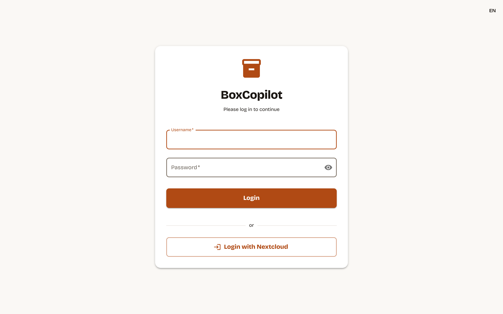

After repeated wrong attempts the login asks you to wait a few minutes. That is the login throttle, see [Security](security.md).

## The dashboard

The left column is the box list, the right column shows the box you opened.

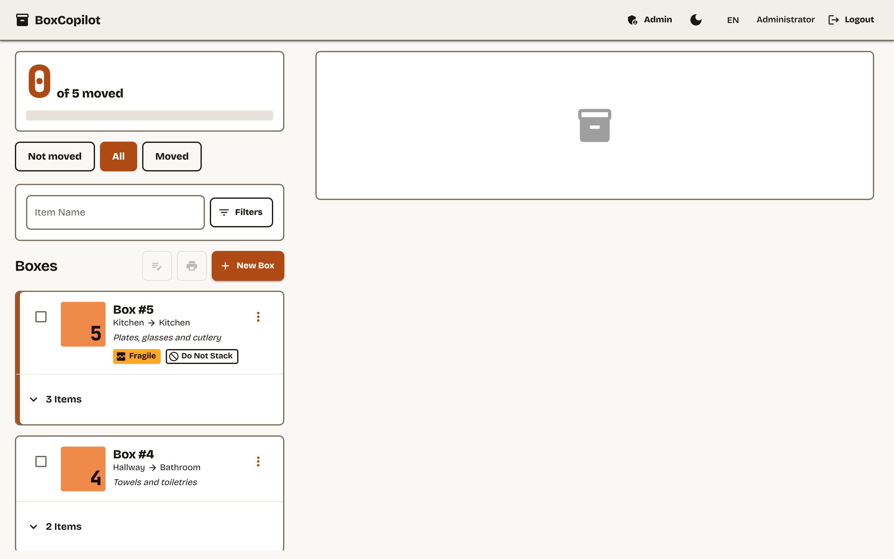

At the top, the progress card counts the boxes that have been moved to their target room. Next to it, Not moved, All and Moved filter the list by status. Each box shows its number on an orange tile, the route from the current to the target room, the description and badges for Fragile and Do Not Stack.

Click the number of items under a box to expand it and see its items with photos.

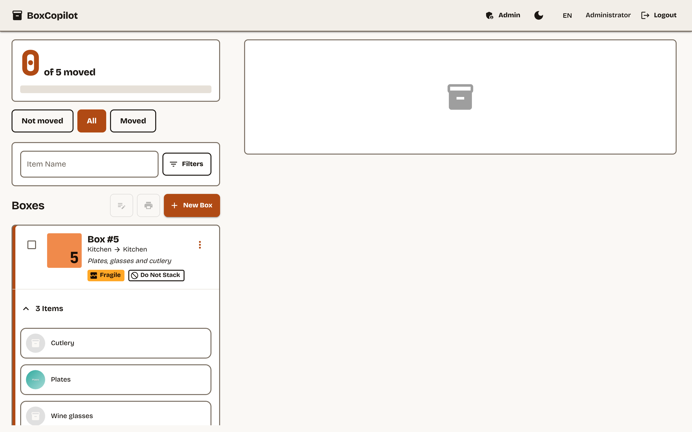

### Searching and filtering

Type an item name to find the box it is in. Filters opens more options: target room, only fragile boxes, only non-stackable boxes, and only boxes with a printed label. The Filters button shows how many filters are active. Reset clears everything.

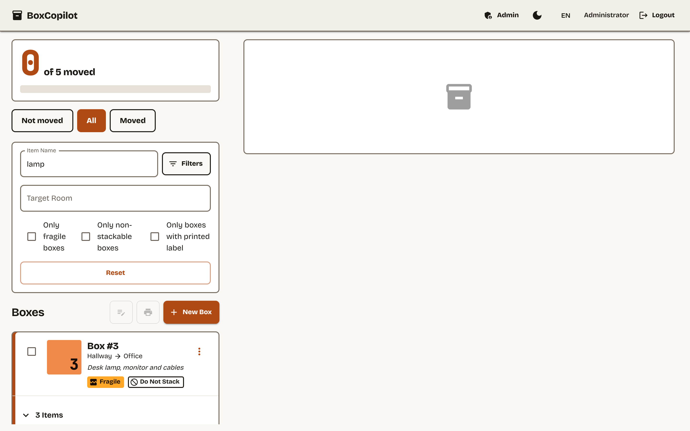

## Creating and editing boxes

New Box opens a dialog for current room, target room, description and the transport notes Fragile and Do Not Stack.

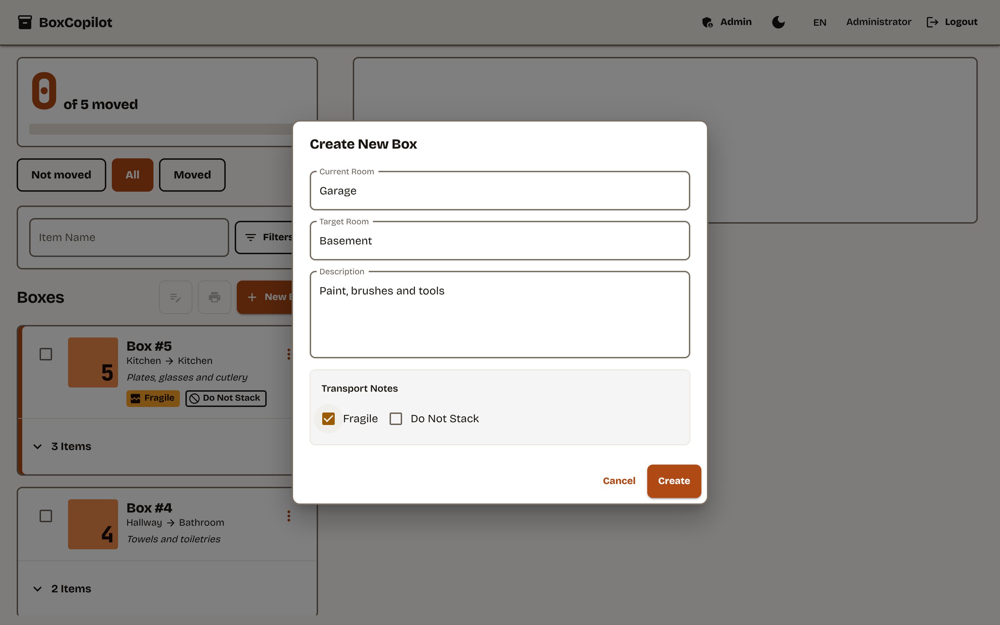

Click a box to open its page. The orange header repeats the route and the handling flags, and the Mark as moved button below it records that the box has reached its target room. Print label prints the label for this box. Edit changes the room names, the description, the transport notes and the status.

Under the header you find the public link of the box (copy it or regenerate it) and the list of items. Each item can be moved to another box, edited or deleted. The round plus button at the bottom right adds an item.

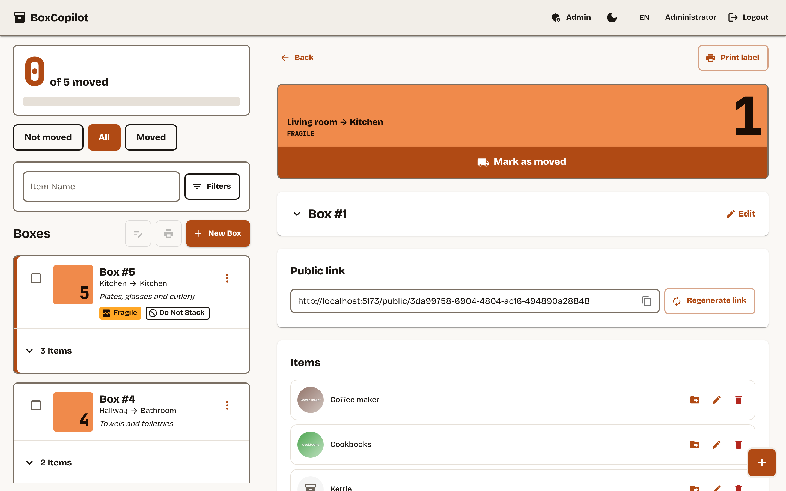

Regenerate link asks for confirmation. The old link and every printed QR label of that box stop working, so print the label again afterwards.

## Adding items with photos

Add an item by name and attach a photo with the in-app camera or from the gallery. Save and next keeps the dialog open for the next item, which is the quick way to pack a box.

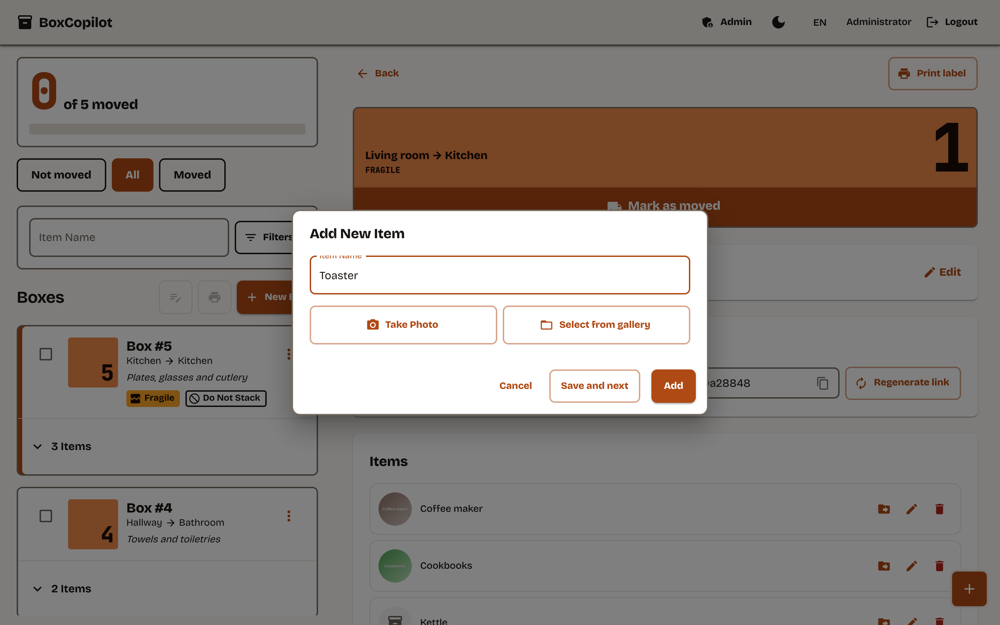

## Printing labels

Tick the boxes in the list and choose Print Labels. The dialog can mark all selected boxes as Label printed in the same step.

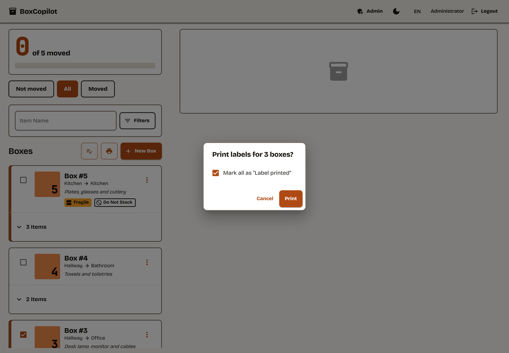

The result is an A4 PDF with three labels per page: box number, handling badges, target room, description and a QR code.

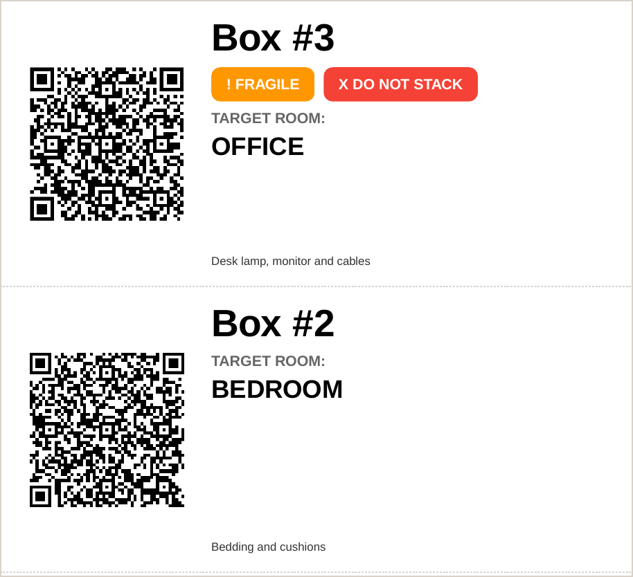

Bulk update, the button next to Print Labels, marks all selected boxes as moved or as label printed.

## The public preview

Scanning the QR code opens a read-only page with the box content and photos. It needs no account, so helpers can check a box without signing in.

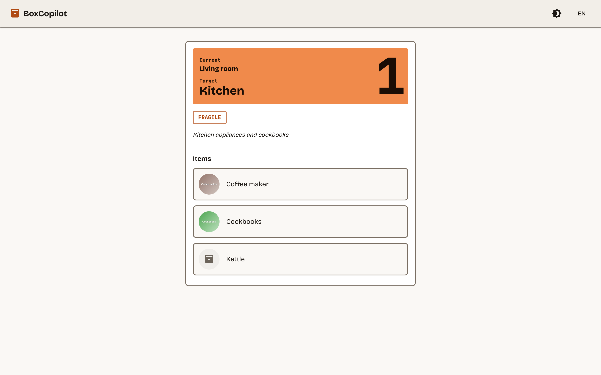

## Administration

Admins open Administration from the top bar. The user table lists username, name, role, status, authentication type and the dates of creation and last login. The actions create and edit users, set a password, create or revoke a magic link, and delete a user.

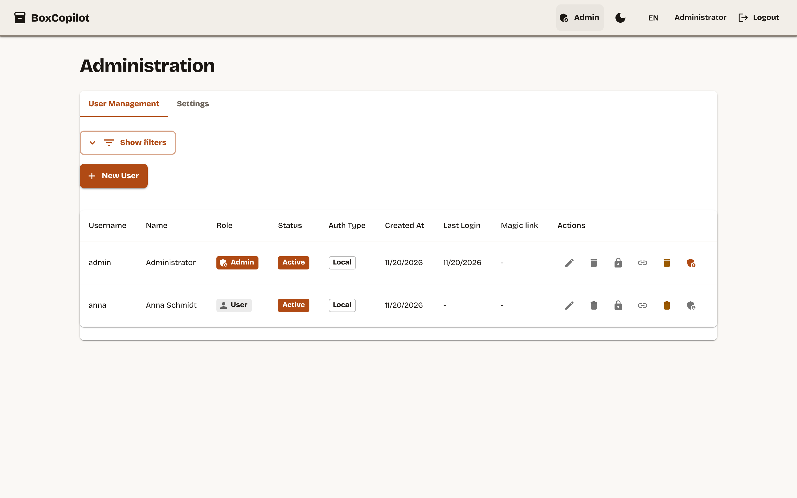

A magic link has a validity that you pick when you create it, from one hour to one month. Setting a password ends all sessions of that user, invalidates their magic links and revokes their Claude access.

## Phone and dark theme

The interface is responsive. On a phone the menu moves into the top bar and the dashboard becomes a single column. The moon and sun button switches the theme, EN and DE switch the language.

  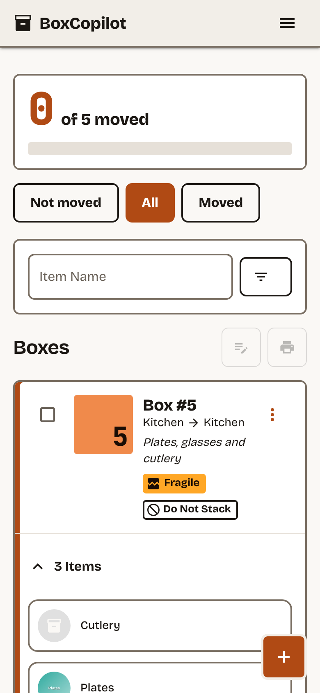
  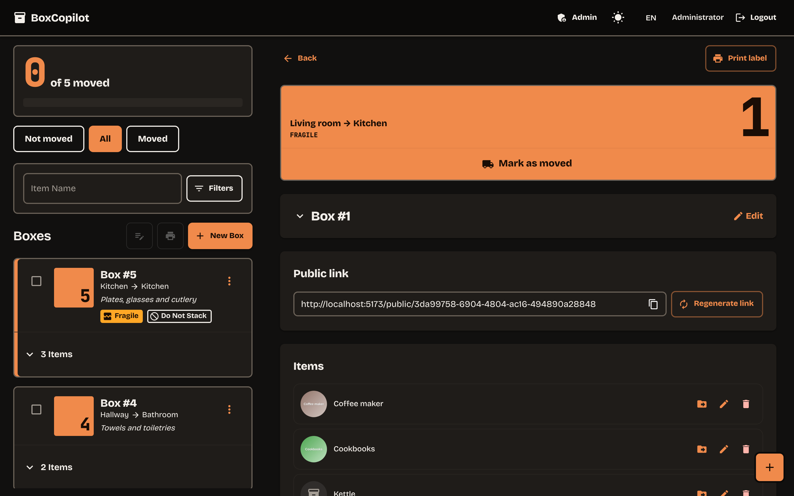

